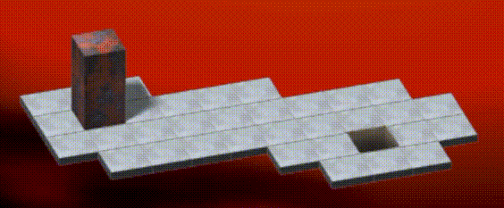

# Bloxorz Solver

Phiên bản 1.1 — 16/10/2026; bản tiếng Việt ngày 17/10/2026. Luật chơi và dữ liệu stage không thay đổi; phiên bản này bổ sung lệnh chạy bài nộp và hướng dẫn đầu ra benchmark.

## Phát biểu bài toán

Cho một bàn chơi và một khối hộp chữ nhật kích thước **1 × 1 × 2**. Ban đầu, khối hộp đứng thẳng trên ô xuất phát. Hãy tìm một chuỗi di chuyển đưa toàn bộ khối hộp đứng thẳng trên ô đích.

**Mọi stage được cung cấp trong dự án đều có lời giải.** Một stage có thể có nhiều chuỗi hành động giải được. Bất kỳ chuỗi nào đưa khối hộp đến đích mà không thua đều được chấp nhận.

## Cách khối hộp di chuyển

Khối hộp có thể đứng thẳng, nằm ngang theo hàng hoặc nằm dọc theo cột. Mỗi bước di chuyển theo một hướng làm khối hộp lăn 90 độ quanh một cạnh:

- Khối đang đứng thẳng đổ xuống và chiếm hai ô tiếp theo theo hướng di chuyển.
- Khối đang nằm nếu lăn theo chiều dài sẽ đứng thẳng trên ô tiếp theo nằm ngoài đầu khối.
- Khối đang nằm nếu lăn sang bên sẽ tiếp tục nằm và dịch đi một ô.



Ảnh động minh họa cách di chuyển. Bố cục thực tế của mỗi stage được xác định bởi bàn chơi trong dữ liệu vào.

## Các loại ô, công tắc và khối nhỏ

| Loại ô | Hành vi |
|---|---|
| Ô thường | Đỡ khối ở mọi tư thế |
| Khoảng trống | Không có mặt sàn; bất kỳ phần nào của khối đi vào đây đều gây thua |
| Ô đích | Chỉ thắng khi toàn bộ khối 1 × 1 × 2 đứng thẳng tại đây |
| Ô dễ vỡ | Đỡ khối hộp đang nằm hoặc một khối nhỏ; vỡ khi khối hộp hoàn chỉnh đứng thẳng lên, gây thua |
| Cầu | Đỡ khối khi bật; tương đương khoảng trống khi tắt |
| Công tắc nhẹ | Được nhấn khi bất kỳ phần nào của khối đang di chuyển đặt lên, kể cả khối nhỏ |
| Công tắc nặng | Chỉ được nhấn bởi khối hộp hoàn chỉnh đang đứng thẳng |
| Ô tách khối | Khi khối hộp hoàn chỉnh đứng thẳng tại đây, dịch chuyển và tách thành hai khối lập phương 1 × 1 × 1 |

Công tắc có thể đảo trạng thái, bật hoặc tắt cầu. Tác dụng vẫn giữ sau khi khối rời đi. Các công tắc khác nhau có thể điều khiển cùng một cầu.

Sau khi tách, mỗi lần di chuyển một trong hai khối nhỏ đi một ô. Khối nhỏ có thể đứng trên ô dễ vỡ và ô đích. **Một khối nhỏ đứng trên ô đích không tạo ra chiến thắng.** Khối nhỏ nhấn được công tắc nhẹ nhưng không kích hoạt công tắc nặng hay ô tách khối. Khi hai khối nhỏ ở hai ô kề nhau theo hàng hoặc cột, chúng tự ghép thành một khối hộp đang nằm. Kề chéo không làm chúng ghép lại.

Khối nhỏ đang đứng yên trên công tắc nhẹ không nhấn lại công tắc khi khối còn lại di chuyển.

## Di chuyển và chi phí

Theo thước đo số bước cơ sở, mỗi bước di chuyển theo hướng có chi phí **1**. Đổi khối nhỏ được chọn có chi phí **0**. Dịch chuyển tức thời, đổi trạng thái cầu, tác dụng công tắc và tự ghép khối không tạo thêm bước. Trường `cost` của checker giữ thước đo này và bằng số bước di chuyển theo hướng. UCS hiện dùng thêm một hàm chi phí có phụ phí riêng, được lưu trong `weighted_cost`; xem bên dưới.

Đi ra ngoài bàn chơi, vào khoảng trống hoặc lên cầu đang tắt đều gây thua. Để khối hộp hoàn chỉnh đứng thẳng trên ô dễ vỡ cũng gây thua. Đây vẫn là các hành động trong game có thể nhận diện, nhưng kết quả là thua; solver phải tránh chúng trong lời giải.

BFS và A* hiện tìm lời giải ít bước nhất; DFS có thể tìm ra lời giải dài hơn. UCS tối ưu `1 + 2 × touches_fragile + touches_bridge + 3 × triggers_split` cho từng hành động hợp lệ, nên có thể chọn đường dài hơn nhưng tổng chi phí nhỏ hơn. Các chỉ báo nhận giá trị 0/1, phụ phí mỗi loại chỉ tính một lần trong một bước. Quy tắc đầy đủ cho khối nhỏ, ghép và dịch chuyển nằm trong [thiết kế UCS](ucs-design.md). Đây là ưu tiên đường đi do nhóm chọn, không phải xác suất thua.

Checker chấp nhận mọi đường đi dẫn đến chiến thắng. `--require-optimal` chỉ so sánh số bước với tham chiếu, phù hợp với BFS/A* hiện tại; không dùng cờ này để chấm UCS có phụ phí. AC không chứng minh tối ưu `weighted_cost`. Khi so sánh tổng chi phí giữa các solver, phải tính lại mọi lời giải bằng cùng công thức UCS, đồng thời báo cáo riêng số bước.

## Dữ liệu vào

Đọc một đối tượng JSON từ stdin (luồng nhập chuẩn):

```json
{
  "id": "sample04",
  "board": [
    "SO.BBBG",
    "#######"
  ],
  "bridges": [
    {"id": "b1", "cells": [[0, 3], [0, 4], [0, 5]], "active": false}
  ],
  "switches": [
    {"at": [0, 1], "effects": [{"bridge": "b1", "mode": "toggle"}]}
  ],
  "splitters": []
}
```

### Các trường dữ liệu vào

Mỗi đối tượng đầu vào phải có đủ các khóa **`id`, `board`, `bridges`, `switches` và `splitters`**. Nếu stage không có cầu, công tắc hoặc ô tách khối, trường tương ứng là mảng rỗng (`[]`).

- `id`: tên hoặc mã định danh stage.
- `board`: bàn chơi hai chiều, biểu diễn bằng một mảng chuỗi, mỗi chuỗi là một hàng.
- `bridges`: các ô thuộc từng nhóm cầu và trạng thái bật/tắt ban đầu.
- `switches`: vị trí và tác dụng lên cầu của từng công tắc nhẹ/nặng.
- `splitters`: vị trí và hai điểm đến dịch chuyển của từng ô tách khối.

Tọa độ có dạng **[hàng, cột]**, đánh số từ 0. Đi lên làm giảm chỉ số hàng; đi sang phải làm tăng chỉ số cột. Toàn bộ tác dụng công tắc và điểm đến dịch chuyển đều được cung cấp; không có thông tin ẩn.

### Ký hiệu trên bàn chơi

| Ký hiệu | Ý nghĩa |
|---|---|
| `#` | Khoảng trống |
| `.` | Ô thường |
| `S` | Ô xuất phát; là ô thường sau khi khối rời đi |
| `G` | Ô đích |
| `F` | Ô dễ vỡ |
| `B` | Ô cầu |
| `O` | Công tắc nhẹ |
| `X` | Công tắc nặng |
| `T` | Ô tách khối |

### Cầu và tác dụng công tắc

Định nghĩa một cầu gồm `id` duy nhất, mảng `cells` không rỗng và giá trị boolean `active` ban đầu. Khi `active` là true, cầu đỡ được khối.

Trường `at` xác định ô của công tắc. Ký hiệu trên bàn chơi xác định công tắc nhẹ hay nặng. Mỗi phần tử trong `effects` chỉ ra một cầu và thao tác:

- `toggle`: đảo trạng thái bật/tắt.
- `on`: bật cầu.
- `off`: tắt cầu.

Thao tác `on` hoặc `off` không khóa trạng thái cầu vĩnh viễn; công tắc khác vẫn có thể thay đổi sau đó. Rời khỏi công tắc không hoàn tác tác dụng của nó.

### Ô tách khối

```json
{"at": [0, 3], "destinations": [[2, 0], [2, 2]]}
```

Đứng thẳng trên `T` tại (0,3) làm khối tách ra. Khối nhỏ **1** xuất hiện tại (2,0), khối nhỏ **2** tại (2,2). Các ID giữ nguyên đến khi ghép lại. Lần tách tiếp theo gán ID theo thứ tự điểm đến của ô tách khối tương ứng.

## Ràng buộc

- 1 ≤ số hàng, số cột ≤ 30.
- Bàn chơi có đúng một `S` và một `G`, ở hai vị trí khác nhau.
- Các hàng dài bằng nhau, chỉ dùng ký hiệu đã liệt kê; mọi tọa độ đều nằm trong bàn chơi.
- Mỗi `B` thuộc đúng một nhóm cầu. Các nhóm không chồng lấn.
- Mỗi `O`/`X` có đúng một định nghĩa công tắc. Mỗi `T` có đúng một định nghĩa ô tách khối.
- Mỗi công tắc có danh sách tác dụng không rỗng. Các ID cầu được tham chiếu phải tồn tại và không lặp lại trong danh sách tác dụng của cùng công tắc.
- Hai điểm đến khi tách là các ô khác nhau, không kề cạnh. Các ô phải đỡ được khối nhỏ khi dịch chuyển xảy ra.
- Các công tắc khác nhau có thể tác động lên cùng một cầu.
- Tất cả stage được cung cấp đều có lời giải.

Giới hạn 30 × 30 là giới hạn đầu vào do dự án lựa chọn.

## Thứ tự xử lý một bước chơi

1. Di chuyển khối hộp hoặc khối nhỏ đang được chọn.
2. Kiểm tra các ô có đỡ được khối không theo trạng thái cầu hiện tại. Rơi hoặc để khối hộp hoàn chỉnh đứng thẳng trên ô dễ vỡ đều gây thua. Khối nhỏ được đứng trên `F` và `G`, nhưng không thắng ở cả hai vị trí. Các khối nhỏ không được chồng lên nhau.
3. Áp dụng các công tắc được khối vừa di chuyển nhấn. Khối đứng yên không nhấn lại công tắc. Nếu nhấn nhiều công tắc, xử lý theo thứ tự hàng tăng dần, rồi cột tăng dần; trong mỗi công tắc, dùng thứ tự tác dụng được liệt kê.
4. Nếu khối hộp hoàn chỉnh đứng thẳng trên ô tách khối, thực hiện dịch chuyển và tách.
5. Kiểm tra lại khả năng đỡ khối sau khi cầu thay đổi và dịch chuyển xảy ra, kể cả với khối đứng yên. Không còn được đỡ thì thua.
6. Ghép hai khối nhỏ kề cạnh theo hàng hoặc cột. Việc ghép không nhấn công tắc thêm lần nữa.
7. Thắng nếu khối hộp hoàn chỉnh đang đứng thẳng trên ô đích. Nếu chưa thắng, chờ hành động tiếp theo.

## Kết quả đầu ra

In một đối tượng JSON chứa `status` và `actions` ra stdout (luồng xuất chuẩn). Dạng tối giản này đủ để kiểm tra tính đúng đắn và dùng trong ví dụ tham chiếu cố định:

```json
{"status": "solved", "actions": ["R", "R", "R", "R"]}
```

Thuật toán chỉ cần in lời giải, không cần tạo file đầu ra. Sau khi tạo danh sách Python `actions`, dùng:

```python
import json

print(json.dumps({"status": "solved", "actions": actions}))
```

Chỉ in đúng một đối tượng JSON ra stdout. Checker chạy bài nộp hoặc runner sẽ thu trực tiếp phần được in; runner lưu file kết quả tổng hợp. Thông báo chẩn đoán nên đưa ra stderr (luồng lỗi chuẩn), ví dụ `print("Searching...", file=sys.stderr)` sau khi nhập `sys`.

### Số liệu bắt buộc khi benchmark

Với các lần benchmark dùng trong báo cáo, thêm `metrics` vào cùng đối tượng JSON được in. Các giá trị dưới đây chỉ minh họa định dạng, không phải số liệu thực nghiệm:

```json
{
  "status": "solved",
  "actions": ["R", "R", "R", "R"],
  "metrics": {
    "search_time_ms": 0.42,
    "expanded_nodes": 8,
    "peak_memory_bytes": 12345,
    "memory_method": "tracemalloc"
  }
}
```

| Trường | Ý nghĩa |
|---|---|
| `search_time_ms` | Số mili giây trôi qua hữu hạn, không âm, cho khởi tạo tìm kiếm, tiền xử lý heuristic, tìm kiếm và truy vết đường đi; không gồm phân tích JSON và in kết quả |
| `expanded_nodes` | Số nguyên không âm đếm các nút không phải đích có sinh trạng thái kế tiếp; bỏ qua phần tử lỗi thời/trùng lặp bị bỏ qua, nhưng tính các lần thực sự mở rộng lại |
| `peak_memory_bytes` | Số nguyên không âm biểu diễn đỉnh cấp phát bộ nhớ Python được theo dõi trong tìm kiếm; không gồm cấp phát có trước khi đo và không phải toàn bộ bộ nhớ tiến trình |
| `memory_method` | `"tracemalloc"` cho phương pháp đo cơ sở dùng chung |

Dùng [template thuật toán](../algorithms/template.py) và [hướng dẫn helper](algorithm-guide.md) để thu thập các trường này nhất quán. Helper đo thời gian tìm kiếm, theo dõi đỉnh cấp phát và in JSON; bạn gọi `metrics.expanded()` ngay trước khi sinh trạng thái kế tiếp của mỗi nút không phải đích. Helper không triển khai tìm kiếm hay áp đặt cách biểu diễn trạng thái của bạn.

Thiếu số liệu hoặc số liệu không hợp lệ không biến một lời giải thắng thành WA. Khi đó bản ghi không đủ điều kiện làm kết quả benchmark đầy đủ và runner báo riêng. Đầu ra tham chiếu giữ nguyên, không chứa giá trị đo. Runner suy ra `solution_length`/`cost` bằng số hành động được chấp nhận và tự đo thời gian toàn tiến trình. UCS bổ sung `metrics.weighted_cost` (số nguyên không âm); runner lưu lại ở `statistics.weighted_cost`. Đây là số liệu solver báo cáo, không được checker chứng nhận tối ưu. Xem [đặc tả runner](runner-proposal.md) về chi phí đo lường và các lần chỉ đo thời gian.

### Hành động

| Khối cần di chuyển | Lên | Xuống | Trái | Phải |
|---|---|---|---|---|
| Khối hộp hoàn chỉnh | `U` | `D` | `L` | `R` |
| Khối nhỏ 1 | `1U` | `1D` | `1L` | `1R` |
| Khối nhỏ 2 | `2U` | `2D` | `2L` | `2R` |

Ví dụ, `1R` chọn khối nhỏ 1 miễn phí rồi di chuyển sang phải, được tính là một bước. UCS cộng phụ phí nếu ô đích của khối đang di chuyển là `F` hoặc `B`. Không có hành động riêng chỉ để đổi khối được chọn.

Chỉ dùng hành động khối nhỏ khi đang tách, và hành động khối hộp hoàn chỉnh khi đang ghép. Kết thúc danh sách hành động ngay khi đạt đích.

<a id="judging"></a>

## Chấm kết quả

### Chạy thuật toán của bạn

Đây là các lệnh đã thống nhất để người phụ trách game triển khai; chúng **chưa sử dụng được**. Sau khi triển khai, chạy từ thư mục gốc của repo. Các ví dụ lần lượt chấm một stage, chấm toàn bộ stage gốc, chạy một stage kèm thống kê/hiển thị 2D và chạy toàn bộ để lưu thống kê:

```bash
# Judge one original stage
python checker.py --algorithm algorithms/BFS.py --test 01 --timeout 10

# Judge all 33 original stages
python checker.py --algorithm algorithms/BFS.py --all --timeout 10

# Run one stage with statistics and terminal playback
python run_tests.py --algorithm algorithms/BFS.py --test 01 --visualize_2d

# Run all original stages and save combined statistics
python run_tests.py --algorithm algorithms/BFS.py --all
```

- `--algorithm PATH`: chương trình thuật toán Python cần chạy.
- `--test NN`: chọn một stage; dùng cờ này hoặc `--all`, không dùng cả hai.
- `--all`: chạy mọi stage trong bộ được chọn.
- `--suite original|samples`: chọn bộ testcase; mặc định là `original`.
- `--timeout SECONDS`: thời gian chạy thuật toán tối đa cho mỗi stage, không gồm kiểm tra kết quả và hiển thị. Khi triển khai phải nêu rõ giá trị mặc định.
- `--visualize_2d`: chỉ dành cho runner, phát lại một stage. Cờ `--visualize_3d` sẽ cung cấp phát lại 3D ở giai đoạn sau.

Cả hai công cụ báo verdict từng stage và tổng số theo kết quả. Runner hiển thị thêm thống kê và lưu một JSON tổng hợp. Mỗi tiến trình thuật toán mới nhận một stage qua stdin và in một lời giải JSON, kể cả khi lệnh bên ngoài chọn toàn bộ stage.

Trước khi các lệnh trên được triển khai, dùng checker phát lại qua file hiện có:

```bash
python algorithms/BFS.py < testcases/original/01.in.json > answer.json
python checker.py --input testcases/original/01.in.json --output answer.json
```

Ký hiệu `>` của shell lưu lời giải được in; thuật toán vẫn không tự ghi file. Lệnh `python checker.py --all` hiện chỉ kiểm tra lời giải tham chiếu đã lưu, không kiểm tra bài nộp thuật toán. Xem [đặc tả runner](runner-proposal.md) để biết hướng dẫn triển khai.

### Verdict

- **Accepted (AC) — chấp nhận:** phát lại kết thúc với khối hộp hoàn chỉnh đứng thẳng trên ô đích và không thua ở bất kỳ bước nào.
- **Wrong Answer (WA) — lời giải không hợp lệ:** đường đi gây thua, dùng hành động sai loại khối so với trạng thái, dừng trước khi thắng, tiếp tục sau khi thắng hoặc báo stage không có lời giải.
- **Runtime Error (RE) — lỗi chương trình/đầu ra:** chương trình gặp lỗi, đầu ra sai định dạng hoặc danh sách hành động chứa mã không được định nghĩa như `JUMP`. Runner in lỗi và chỉ ra hành động gây lỗi nếu có thể.
- **Time Limit Exceeded (TLE) — vượt giới hạn thời gian:** runner dừng chương trình khi vượt giới hạn thời gian đã cấu hình.

Checker phát lại các hành động. Nó không so sánh chuỗi hành động với một đáp án duy nhất và không tự giải stage. Đầu ra tham chiếu cung cấp một lời giải hợp lệ cho mỗi stage.

## Ví dụ

Các ví dụ nhỏ này tách biệt với 33 stage của game gốc.

### Ví dụ 1 — lăn để đứng thẳng và lăn sang bên

Dữ liệu vào:

```json
{
  "id": "sample02",
  "board": [
    "S..#",
    "#..#",
    "#..#",
    "#..G"
  ],
  "bridges": [],
  "switches": [],
  "splitters": []
}
```

Kết quả đầu ra:

```json
{"status":"solved","actions":["R","D","D","D","R"]}
```

Bước sang phải làm khối nằm trên cột 1–2. Ba bước xuống lăn khối sang bên đến hàng 3. Bước sang phải cuối cùng dựng khối đứng trên ô đích. Chi phí: 5.

### Ví dụ 2 — ô dễ vỡ

Dữ liệu vào:

```json
{
  "id": "sample03",
  "board": [
    "SFFG",
    "####"
  ],
  "bridges": [],
  "switches": [],
  "splitters": []
}
```

Kết quả đầu ra:

```json
{"status":"solved","actions":["R","R"]}
```

Khối nằm trên các ô dễ vỡ rồi đứng thẳng trên ô đích. Chi phí: 2.

### Ví dụ 3 — công tắc nhẹ và cầu

Dùng toàn bộ dữ liệu vào đã trình bày trong phần Dữ liệu vào.

Kết quả đầu ra:

```json
{"status":"solved","actions":["R","R","R","R"]}
```

Lần lăn đầu nhấn `O`, bật cả ba ô cầu. Các bước còn lại đi qua cầu và đến đích. Chi phí: 4.

### Ví dụ 4 — tách và ghép khối

Dữ liệu vào:

```json
{
  "id": "sample06",
  "board": [
    "S..T",
    "####",
    "...G"
  ],
  "bridges": [],
  "switches": [],
  "splitters": [
    {"at":[0,3],"destinations":[[2,0],[2,2]]}
  ]
}
```

Kết quả đầu ra:

```json
{"status":"solved","actions":["R","R","1R","R"]}
```

Hai bước sang phải đến `T`. Hai khối nhỏ xuất hiện tại (2,0) và (2,2). Khối nhỏ 1 sang phải, làm chúng kề nhau và ghép lại. Khối hộp hoàn chỉnh lăn sang phải lên ô đích. Chi phí: 4.

## Bảng tham chiếu tư thế

Bảng này hỗ trợ triển khai di chuyển, không quy định phải dùng lớp nội bộ nào. Quy ước Upright(r,c) là đứng thẳng; Horizontal(r,c) là nằm ngang, chiếm (r,c),(r,c+1); Vertical(r,c) là nằm dọc, chiếm (r,c),(r+1,c).

| Tư thế hiện tại | Lên | Xuống | Trái | Phải |
|---|---|---|---|---|
| Upright(r,c) | Vertical(r−2,c) | Vertical(r+1,c) | Horizontal(r,c−2) | Horizontal(r,c+1) |
| Horizontal(r,c) | Horizontal(r−1,c) | Horizontal(r+1,c) | Upright(r,c−1) | Upright(r,c+2) |
| Vertical(r,c) | Upright(r−1,c) | Upright(r+2,c) | Vertical(r,c−1) | Vertical(r,c+1) |
